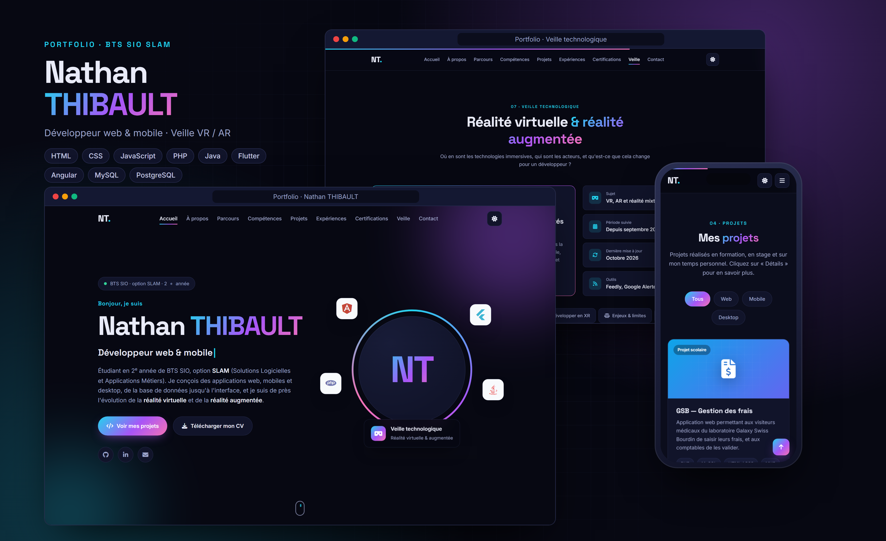

# Projet_Portfolio

Portfolio de **Nathan THIBAULT**, étudiant en 2<sup>e</sup> année de **BTS SIO option SLAM** (Solutions Logicielles et Applications Métiers).

🌐 **Voir le site en ligne :** https://zixow.github.io/Projet_Portfolio/



## Contenu

- **À propos** : présentation et objectifs
- **Parcours scolaire** : du baccalauréat au BTS SIO SLAM
- **Compétences** : HTML, CSS, JavaScript, Angular, PHP, Java, Flutter, MySQL, PostgreSQL
- **Projets** : projets réalisés en formation, en stage et en personnel
- **Expériences** : stages en entreprise
- **Certifications** : Pix, SecNumacadémie (ANSSI), Atelier RGPD (CNIL)…
- **Veille technologique** : la réalité virtuelle et la réalité augmentée
- **Contact**

## Technologies

Site statique réalisé sans framework :

- **HTML5** sémantique et accessible
- **CSS3** : Grid, Flexbox, variables, thème clair / sombre, responsive
- **JavaScript** : animations au défilement, filtres, fenêtre modale, onglets, validation du formulaire, fond animé en Canvas

## Structure

```
Projet_Portfolio/
├── index.html        # Page principale
├── css/style.css     # Styles
├── js/script.js      # Interactions
└── assets/           # Images, CV
```

## Lancer le projet

Aucune installation nécessaire : ouvrir `index.html` dans un navigateur.
