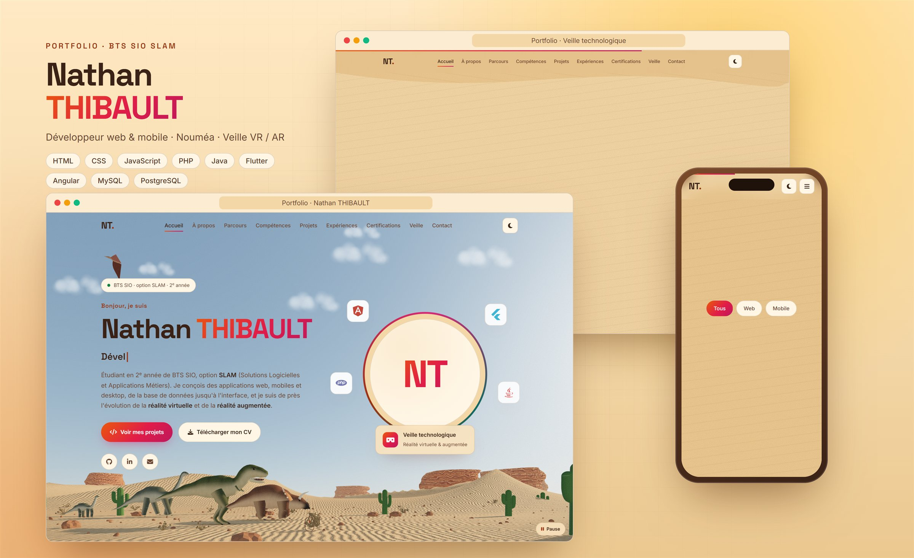

# Projet_Portfolio

Portfolio de **Nathan THIBAULT**, étudiant en 2<sup>e</sup> année de **BTS SIO option SLAM** (Solutions Logicielles et Applications Métiers).

🌐 **Voir le site en ligne :** https://zixow.github.io/Projet_Portfolio/



## Pages

| Page | Contenu |
| --- | --- |
| `index.html` | **Accueil** : mon bureau en 3D (inspiré de ma chambre) avec un mur décoré de cadres cliquables (mon CV, mes projets, ma veille), présentation, téléchargement du CV et accès rapide aux autres pages |
| `parcours.html` | **Parcours scolaire** (du baccalauréat au BTS SIO SLAM) et **expériences en entreprise** (stages) |
| `competences.html` | **Compétences** (HTML, CSS, JavaScript, Angular, PHP, Java, Flutter, MySQL, PostgreSQL) et **certifications** |
| `projets.html` | **Projets** : PixelStar (site web PHP / MySQL) et Caillou Tour (application mobile Flutter, projet de POO en binôme : [code](https://github.com/zixow/POO_nathan_weinim) et [conception UML](https://github.com/zixow/PO-Nathan-Weimin)) |
| `veille.html` | **Veille technologique** : la réalité virtuelle et la réalité augmentée |
| `synthese.html` | **Tableau de synthèse BTS** : compétences du bloc 1 (E5) et du bloc 2 (E6) mobilisées dans chaque réalisation |
| `contact.html` | **Contact** : coordonnées et formulaire |

## Technologies

Site statique réalisé sans framework :

- **HTML5** sémantique et accessible
- **CSS3** : Grid, Flexbox, variables, thème « chambre » de jour / de nuit (mur crème, tasseaux de chêne, plateau de bureau), responsive
- **JavaScript** : en-tête et pied de page communs, animations au défilement, filtres, fenêtre modale, onglets, validation du formulaire
- **Three.js (3D)** : sur la page d'accueil, mon bureau reconstitué en 3D d'après ma chambre : mur en tasseaux de chêne, bureaux en bois et métal, étagère de figurines avec une plante, écran qui affiche le code de Caillou Tour en train de s'écrire, console, manettes, PC aux ventilateurs RGB, néon « NT. » et tapis. Sur le mur crème : une fenêtre avec vue sur le lagon, des cadres sur lesquels on peut cliquer (mon CV, Caillou Tour, PixelStar, ma veille), une horloge qui donne l'heure, un meuble bas et une guirlande lumineuse. Le soleil de fin d'après-midi dessine la forme d'une fenêtre sur le mur et le sol (avec de la poussière qui brille dans la lumière) ; la nuit, clair de lune, néon et rubans LED. Textures dessinées par le code ; version 2D en Canvas si la 3D n'est pas disponible

## Structure

```
Projet_Portfolio/
├── index.html, parcours.html, competences.html, projets.html,
│   veille.html, synthese.html, contact.html      # une page par partie
├── css/
│   ├── base.css            # variables, thèmes jour / nuit, typographie, boutons, cartes (toutes les pages)
│   ├── mise-en-page.css    # en-tête, sections (mur crème / tasseaux), pied de page (toutes les pages)
│   └── accueil.css, parcours.css, competences.css,
│       projets.css, veille.css, synthese.css, contact.css   # styles propres à chaque page
├── js/
│   ├── composants.js       # en-tête et pied de page, écrits une seule fois pour toutes les pages
│   ├── commun.js           # thème, menu mobile, apparition au défilement… (toutes les pages)
│   ├── accueil.js          # effet machine à écrire, compteurs, choix 3D / 2D
│   ├── setup3d.js          # mon bureau en 3D (Three.js)
│   ├── setup2d.js          # version 2D de secours (Canvas)
│   └── competences.js, projets.js, veille.js, contact.js    # scripts propres à chaque page
└── assets/                 # CV (PDF + aperçu), captures des projets, icône du site
```

Pour ajouter une page : copier une page existante, changer `data-page` sur la balise `<body>`, puis l'ajouter dans la liste `PAGES` de `js/composants.js` (le menu se met à jour sur toutes les pages).

## Lancer le projet

Aucune installation nécessaire : ouvrir `index.html` dans un navigateur.
