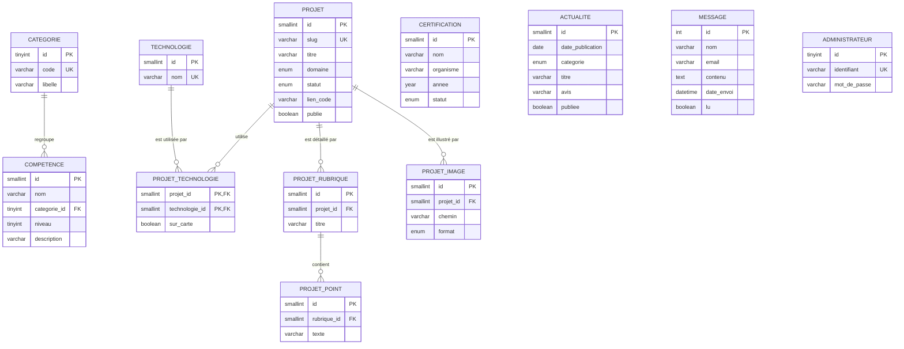

# Projet_Portfolio

Portfolio de **Nathan THIBAULT**, étudiant en 2<sup>e</sup> année de **BTS SIO option SLAM** (Solutions Logicielles et Applications Métiers).

🌐 **Voir le site en ligne :** https://zixow.github.io/Projet_Portfolio/


## Pages

| Page | Contenu |
| --- | --- |
| `index.html` | **Accueil** : mon bureau en 3D (inspiré de ma chambre) avec un mur décoré de cadres cliquables (mon CV, mes projets, ma veille), présentation, téléchargement du CV et accès rapide aux autres pages |
| `parcours.html` | **Parcours scolaire** (du baccalauréat au BTS SIO SLAM) et **expériences en entreprise** (stages) |
| `competences.html` | **Compétences** (HTML, CSS, JavaScript, Angular, PHP, Java, Flutter, MySQL, PostgreSQL) et **certifications** |
| `projets.html` | **Projets** : PixelStar (site web PHP / MySQL, [code](https://github.com/zixow/projet-steam-php-html-css)), Caillou Tour (application mobile Flutter, projet de POO en binôme : [code](https://github.com/zixow/POO_nathan_weinim) et [conception UML](https://github.com/zixow/PO-Nathan-Weimin)) et ce portfolio |
| `veille.html` | **Veille technologique** : la réalité virtuelle et la réalité augmentée, en version courte (l'essentiel, mes actualités et mon avis) |
| `synthese.html` | **Tableau de synthèse BTS** : compétences du bloc 1 (E5) et du bloc 2 (E6) mobilisées dans chaque réalisation |
| `contact.html` | **Contact** : coordonnées et formulaire |

## Technologies

Site réalisé sans framework, avec une base de données :

- **HTML5** sémantique et accessible
- **CSS3** : Grid, Flexbox, variables, thème « chambre » de jour / de nuit (mur crème, tasseaux de chêne, plateau de bureau), responsive
- **JavaScript** : en-tête et pied de page communs, contenu affiché d'après la base de données, animations au défilement, filtres, fenêtre modale, validation du formulaire
- **PHP 8 et MySQL** : base de données de 12 tables, API qui renvoie le contenu en JSON, formulaire de contact enregistré, espace d'administration sécurisé
- **Three.js (3D)** : sur la page d'accueil, mon bureau reconstitué en 3D d'après ma chambre : mur en tasseaux de chêne, bureaux en bois et métal, étagère de figurines avec une plante, écran qui affiche le code de Caillou Tour en train de s'écrire, console, manettes, PC aux ventilateurs RGB, néon « NT. » et tapis. Sur le mur crème : une fenêtre avec vue sur le lagon, des cadres sur lesquels on peut cliquer (mon CV, Caillou Tour, PixelStar, ma veille), une horloge qui donne l'heure, un meuble bas et une guirlande lumineuse. Le soleil de fin d'après-midi dessine la forme d'une fenêtre sur le mur et le sol (avec de la poussière qui brille dans la lumière) ; la nuit, clair de lune, néon et rubans LED. Textures dessinées par le code ; version 2D en Canvas si la 3D n'est pas disponible

## Structure

```
Projet_Portfolio/
├── index.html, parcours.html, competences.html, projets.html,
│   veille.html, synthese.html, contact.html      # une page par partie
├── css/
│   ├── base.css            # variables, thèmes jour / nuit, typographie, boutons, cartes (toutes les pages)
│   ├── mise-en-page.css    # en-tête, sections (mur crème / tasseaux), pied de page (toutes les pages)
│   └── accueil.css, parcours.css, competences.css,
│       projets.css, veille.css, synthese.css, contact.css   # styles propres à chaque page
├── js/
│   ├── composants.js       # en-tête et pied de page, écrits une seule fois pour toutes les pages
│   ├── commun.js           # thème, menu mobile, apparition au défilement… (toutes les pages)
│   ├── accueil.js          # effet machine à écrire, compteurs, choix 3D / 2D
│   ├── setup3d.js          # mon bureau en 3D (Three.js)
│   ├── setup2d.js          # version 2D de secours (Canvas)
│   ├── donnees.js          # charge le contenu : base de données (API) ou copie data/contenu.js
│   └── competences.js, projets.js, veille.js, contact.js    # scripts propres à chaque page
├── api/                    # API PHP : contenu.php (contenu en JSON), contact.php (messages)
│   ├── config.php          # connexion à la base (XAMPP par défaut ; config.local.php sur un hébergeur)
│   └── lib/                # connexion PDO, lecture du contenu, export de la copie
├── admin/                  # espace d'administration (connexion, messages, actualités, compétences…)
├── outils/                 # en ligne de commande : creer-admin.php, exporter.php
├── database/portfolio.sql  # structure et contenu de la base
├── data/contenu.js         # copie de la base pour GitHub Pages (générée automatiquement)
└── assets/                 # CV (PDF + aperçu), captures des projets, icône du site
```

`404.html` est la page affichée par GitHub Pages quand une adresse n'existe pas. Le lien direct `projets.html#pixelstar` (ou `#caillou-tour`, `#portfolio`) ouvre les détails du projet.

Pour ajouter une page : copier une page existante, changer `data-page` sur la balise `<body>`, puis l'ajouter dans la liste `PAGES` de `js/composants.js` (le menu se met à jour sur toutes les pages).

## Base de données

Le contenu du portfolio est enregistré dans une base **MySQL** (`portfolio_nathan`) : projets, technologies, compétences, certifications, actualités de la veille et messages du formulaire de contact.

- **Avec PHP** (XAMPP, ou un hébergeur PHP / MySQL) : les pages lisent la base en direct grâce à l'API `api/contenu.php`, le formulaire de contact enregistre les messages et l'administration permet de tout modifier.
- **Sur GitHub Pages** (pas de PHP ni de MySQL) : les pages lisent `data/contenu.js`, une copie de la base mise à jour automatiquement à chaque modification dans l'administration. Il suffit ensuite de faire un *commit* et un *push*. Le formulaire de contact ouvre alors la messagerie du visiteur.

### Schéma



### Sécurité

- requêtes préparées (PDO) : pas d'injection SQL possible ;
- mots de passe des administrateurs hachés avec `password_hash`, jamais enregistrés en clair ;
- jeton CSRF sur tous les formulaires de l'administration, session sécurisée et nombre d'essais de connexion limité ;
- textes de la base échappés avant affichage (pas d'injection de code) ;
- formulaire de contact : vérification côté serveur, champ piège contre les robots, 5 messages par heure au maximum ;
- identifiants de la base d'un hébergeur dans `api/config.local.php`, un fichier non publié sur GitHub.

## Lancer le projet

**Sans base de données** : ouvrir `index.html` dans un navigateur (le site utilise la copie `data/contenu.js`).

**Avec la base de données (XAMPP)** :

1. Démarrer **MySQL** dans le panneau de contrôle de XAMPP.
2. Importer `database/portfolio.sql` dans phpMyAdmin (onglet *Importer*).
3. Créer votre compte administrateur, dans le dossier du portfolio : `php outils/creer-admin.php votre-identifiant`
4. Lancer le site : `php -S localhost:8000`, puis ouvrir http://localhost:8000
5. Administration : http://localhost:8000/admin/

Si la commande `php` n'est pas reconnue, utilisez celle de XAMPP : `C:\xampp\php\php.exe`.
